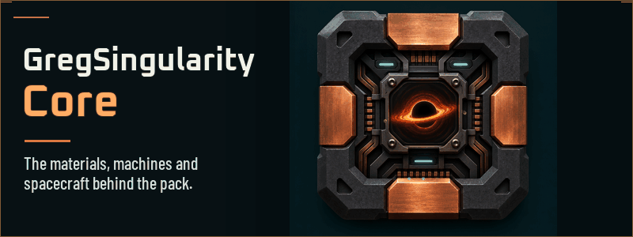
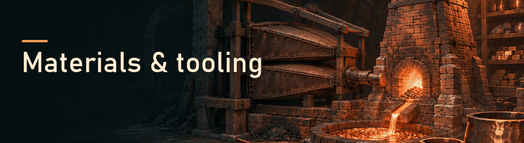

# GregSingularity Core

<picture>
  <source media="(prefers-reduced-motion: reduce)" srcset="../../branding/public/core-cover.jpg">
  
</picture>

The Forge mod that supplies the custom materials, field metallurgy, industrial recipes and spaceflight systems for GregSingularity. Its scripts and assets ship inside one JAR.

<picture>
  <source media="(prefers-reduced-motion: reduce)" srcset="../../branding/public/core-tools.jpg">
  
</picture>

GregTech knives, saws and hammers work across material tiers. A copper mining hammer cuts a 3×3 face and switches to a single block while sneaking. Russian and English tooltips explain the next operation, its output or the way a tool is handled.

<picture>
  <source media="(prefers-reduced-motion: reduce)" srcset="../../branding/public/core-space.jpg">
  
</picture>

Three piloted Ad Astra rockets serve Ceres, Europa and Titan. Each takes a dedicated fuel. Planetary ore lines combine mechanical separation, chemical processing, crystallization and blast-furnace treatment.

<picture>
  <source media="(prefers-reduced-motion: reduce)" srcset="../../branding/public/core-install.jpg">
  
</picture>

Install the matching [GregSingularity pack](https://www.curseforge.com/minecraft/modpacks/gregsingularity) for its quests and configuration. For manual updates, back up the profile, remove the previous Core JAR and place the new JAR in mods on both client and server. [Release files](https://github.com/klaran3e-hub/GregSingularity/releases) · [Community and bug reports](https://discord.gg/PppDQ2ZE6P).

## Building from source

Use Java 17, the Forge 1.20.1 libraries and the matching pack dependencies. Run the following from the repository root with Node.js 20 or newer. The build generates the bilingual catalog and packages the game scripts, sounds and resources.

```sh
node addons/gtibd-core/build.cjs "/path/to/GregSingularity/mods"
```

The JAR is written to `dist/GregSingularity-Core-0.1.0/`. Minecraft retains the original registry IDs for existing worlds.
