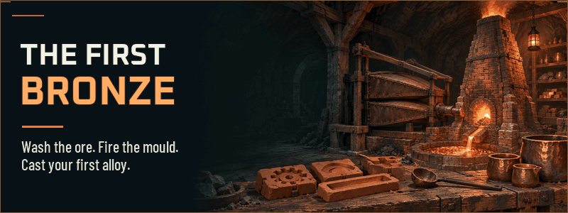
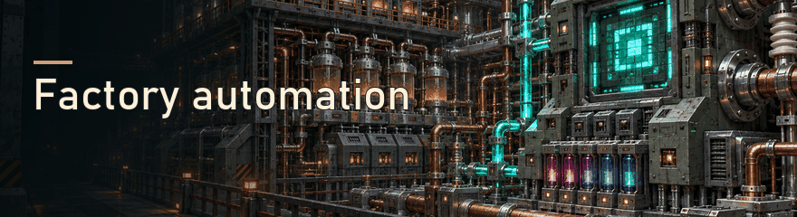

The first furnace is a field bloomery you build yourself. The last shift asks for a working factory, reserve power and deliveries from three dimensions. GregSingularity is an expert industrial pack for Minecraft 1.20.1, Forge and Java 17.

Cut timber with GregTech tools, wash crushed ore and prepare clay crucibles. Build the elongated bloomery and cast your first bronze. Steam machines take over crushing and smelting when the workshop can feed a boiler.

Start an ME network at MV. Encode processing patterns for parts and fluids, connect GregTech and PneumaticCraft equipment, and keep the refinery supplied. The quest book connects the workshop, voltage tiers and optional branches across 22 chapters.

Space opens the path to EV. Build a supply route through Mars and Venus, then fly Tier V to Ceres, Tier VI to Europa and Tier VII to Titan. Each of these three rockets takes its own fuel. Eight sites have ore-processing lines that begin on the body where the deposit was mined.

[Download the pack](https://www.curseforge.com/minecraft/modpacks/gregsingularity) · [GregSingularity Core](https://www.curseforge.com/minecraft/mc-mods/gregsingularity-core) · [GitHub releases](https://github.com/klaran3e-hub/GregSingularity/releases) · [Community Discord](https://discord.gg/PppDQ2ZE6P). Share factory layouts or report a bug with your version and reproduction steps. Back up your save and import 0.2.0 into a fresh profile. The early progression and world generation were redesigned.

CC: Tweaked by Daniel Ratcliffe, SquidDev and contributors is included under its [licenses](https://github.com/cc-tweaked/CC-Tweaked/tree/v1.20.1-1.116.1). The illustrated banners were generated for GregSingularity.
