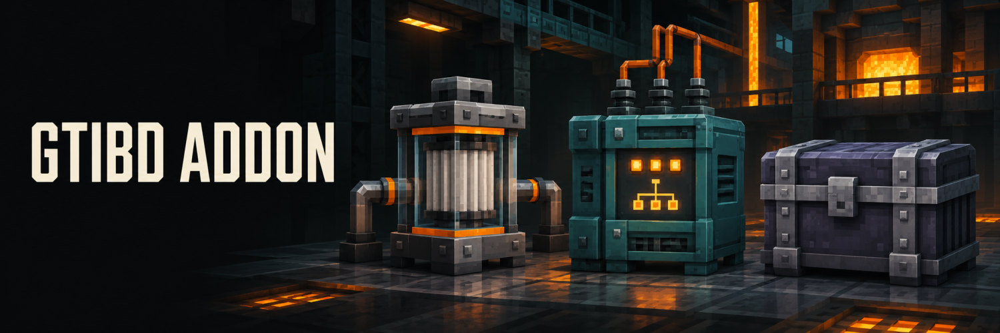
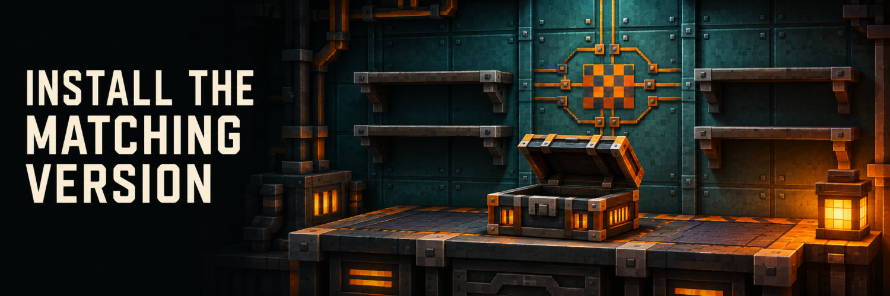

# GTIBD Addon

The KubeJS customization scripts and resources from **GregTech: Industrial Brain Damage 0.0.1**. This download contains the same KubeJS folder as the matching modpack.

- Startup and server scripts register custom items and fluids and define recipes from hand tools and Create through GregTech and the post-UV factory.
- Recipe integrations cover Immersive Engineering, PneumaticCraft, AE2, ExtendedAE and the other mods in the matching pack.
- Client scripts and resources provide JEI cleanup, English and Russian item names, 347 item sprites and textures used in the quest book.
- The factory scripts track cold start, emergency power and simultaneous production on three lines.

## Install or restore

Use the full **GregTech: Industrial Brain Damage 0.0.1** profile for Minecraft 1.20.1 with Forge 47.4.28 and Java 17. The modpack already includes the addon's files. Keep its full mod list, settings and FTB Quests chapters installed.

1. Close the game and stop the matching server if you use one.
2. Back up the profile and saves. On a server, back up its directory and worlds.
3. Move the existing `kubejs` folder out of the profile and keep it as a backup. Extract the new `kubejs` folder next to `mods` and `config`. Apply the same replacement to the matching server if needed.
4. Verify the path `<profile>/kubejs/startup_scripts`, then start the game or server.

[GitHub project](https://github.com/klaran3e-hub/gregtech-industrial-brain-damage) · [Discord](https://discord.gg/PppDQ2ZE6P)

The banners on this page are AI-generated illustrations.
