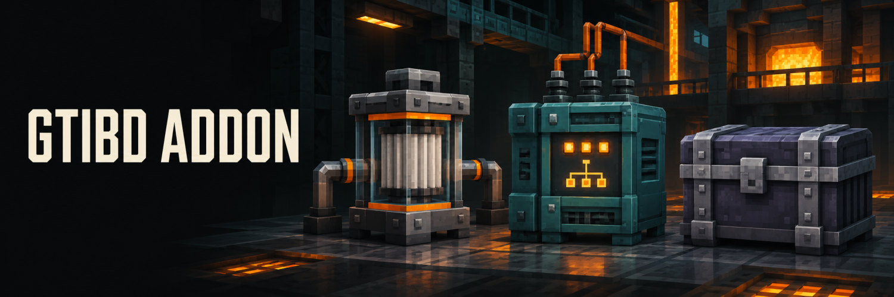
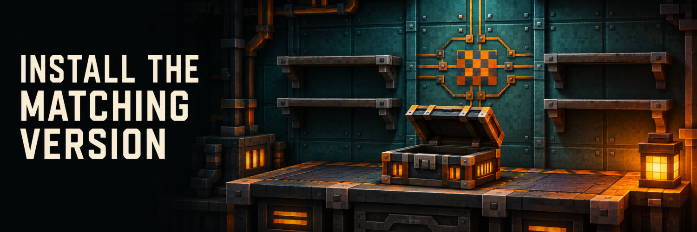

# GTIBD Addon

Скрипты и ресурсы KubeJS из **GregTech: Industrial Brain Damage 0.0.1**. В архиве лежит та же папка KubeJS, которая входит в сборку этой версии.

- Скрипты запуска и сервера регистрируют предметы, жидкости и рецепты от ручных инструментов и Create до GregTech и завода после UV.
- Рецепты связывают Immersive Engineering, PneumaticCraft, AE2, ExtendedAE и остальные моды сборки.
- Клиентская часть скрывает недоступные предметы в JEI. В ресурсах есть русские и английские названия, 347 иконок предметов и текстуры для книги квестов.
- Заводская автоматика отслеживает холодный пуск, аварийное питание и одновременную работу трёх линий.

## Установка или восстановление

Используй полный профиль **GregTech: Industrial Brain Damage 0.0.1** с Minecraft 1.20.1, Forge 47.4.28 и Java 17. Файлы аддона уже входят в сборку. Для работы нужны её моды, настройки и главы FTB Quests.

1. Закрой Minecraft и останови сервер, если он используется.
2. Сделай резервную копию профиля и сохранений. Для сервера сохрани копию его папки и миров.
3. Перенеси прежнюю папку `kubejs` из профиля в резервную копию. Распакуй новую папку `kubejs` рядом с `mods` и `config`. При необходимости так же обнови сервер этой версии.
4. Проверь путь `<профиль>/kubejs/startup_scripts`, затем запусти игру или сервер.

[Проект на GitHub](https://github.com/klaran3e-hub/gregtech-industrial-brain-damage) · [Discord](https://discord.gg/PppDQ2ZE6P)

Баннеры на странице созданы с помощью ИИ.
