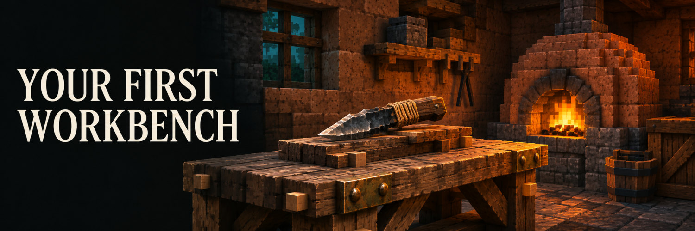
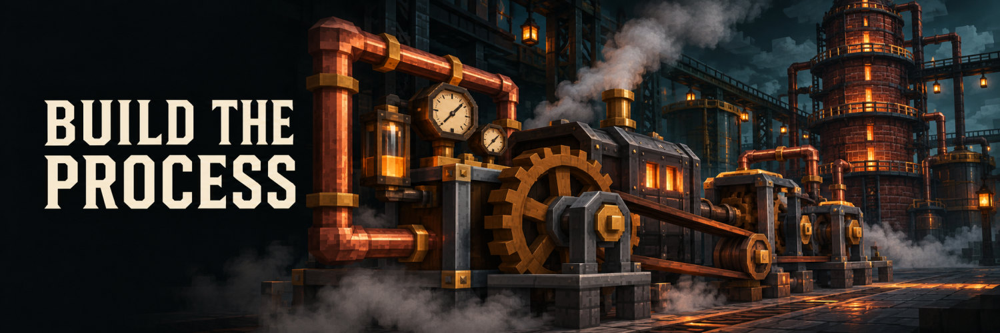
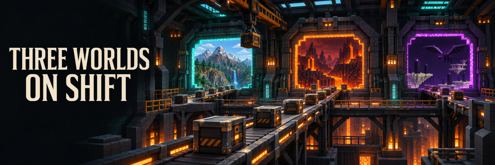
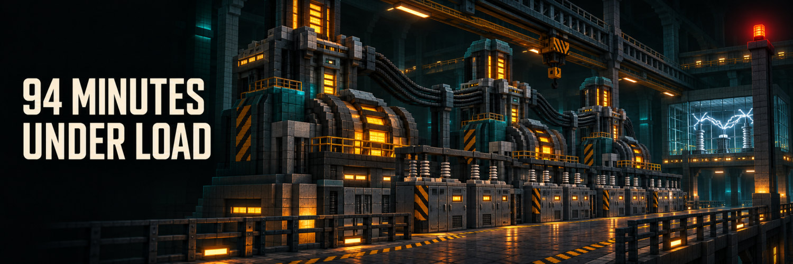
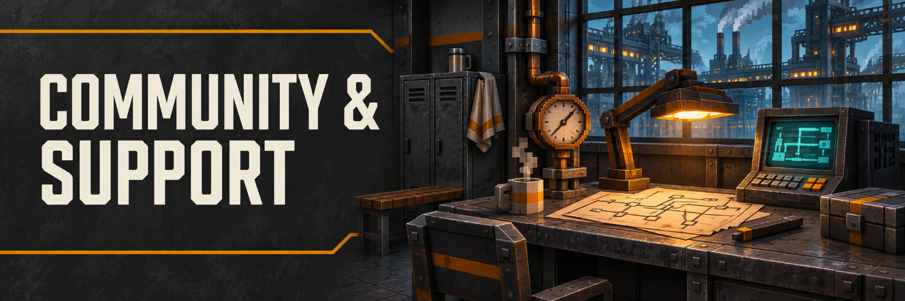

# GregTech: Industrial Brain Damage

A hardcore expert modpack for **Minecraft 1.20.1, Forge 47.4.28 and Java 17**. Build your first tools by hand, run a workshop with Create, bring up a steam plant and work your way through GregTech from LV to UV. Beyond UV, three production stages lead to the commissioning of a factory supplied from three dimensions.

A log split by hand with a knife yields **two planks** and wears down the blade. A Create Mechanical Saw yields **four**. The same tradeoff carries through the pack. Better materials and equipment earn their place by improving yield, throughput or control over a process.

## Build one connected factory

- Create handles early mechanical power, cutting, mixing and pressing. GregTech takes over steam, electricity, metallurgy and industrial chemistry.
- Immersive Engineering supplies presswork and heavy equipment. PneumaticCraft adds pressure chambers, seals and polymers to the same production chains.
- Basic drawers provide local storage. The drawer controller and the first AE2 storage network open at MV. Processing patterns follow at HV. ExtendedAE adds buffers for items and fluids and helps route them to ordered GregTech assembly lines.
- Forestry tree farms open at LV. Forestry and Gendustry beekeeping open at HV. Create trains form an optional logistics branch alongside item and fluid pipes.

## Follow the production chains

**2,126 quests across 19 chapters** connect machines, materials and the next production step. The chapters cover the starting workshop, voltage tiers and branches such as AE2, forestry and railways. Route materials across the Overworld, Nether and End. Build the post-UV operations, recovery and distribution lines, then send warm coolant and spent electrolyte back for reprocessing.

## Commission the factory

Start on reserve power, switch to the main supply and run two five-minute outage drills. After the 90-minute main shift, complete two separate two-minute tests with the metal, polymer and electronics lines working together. Submit five records and a network certificate. The final assembly recipe uses 15 ordered item inputs and four fluids.

**To install**, import the modpack ZIP in CurseForge and start a new world for the intended progression. Back up existing saves before upgrading. Use the FTB Quests book for your next objective and JEI for recipe details. The pack includes an animated loading screen, a custom main menu and a custom pause screen.

## Project and credits

Share bugs, production layouts or questions on [Discord](https://discord.gg/PppDQ2ZE6P). Project files and issue tracking are on [GitHub](https://github.com/klaran3e-hub/gregtech-industrial-brain-damage).

The pack bundles the official CC: Tweaked 1.116.1 Forge build by Daniel Ratcliffe, SquidDev and the CC: Tweaked contributors. [Official download](https://modrinth.com/mod/cc-tweaked/version/OMIJHNkd) · [Source and licenses](https://github.com/cc-tweaked/CC-Tweaked/tree/v1.20.1-1.116.1)

The banners on this page are AI-generated illustrations.
