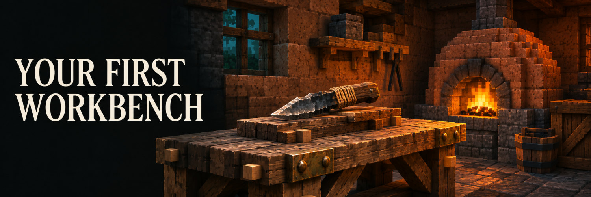
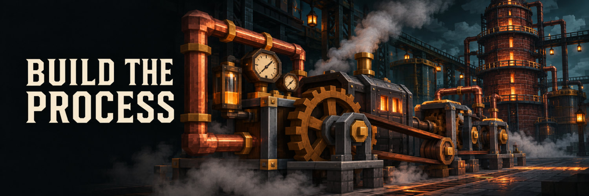
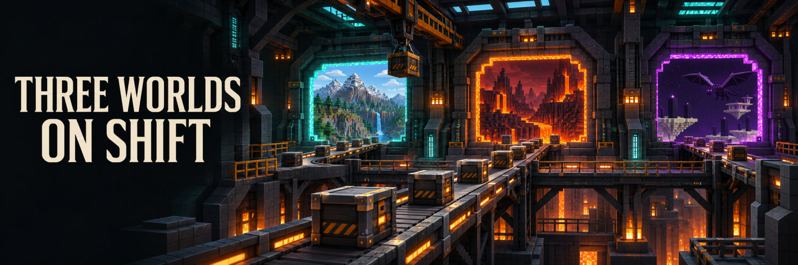
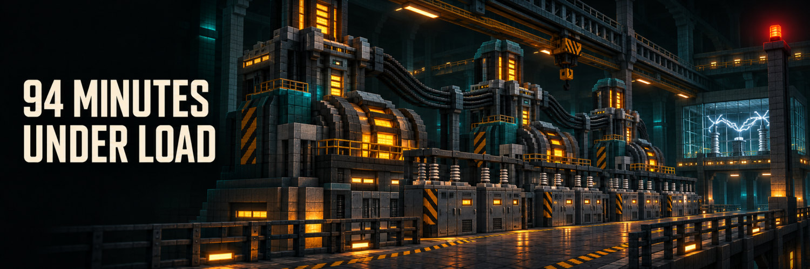
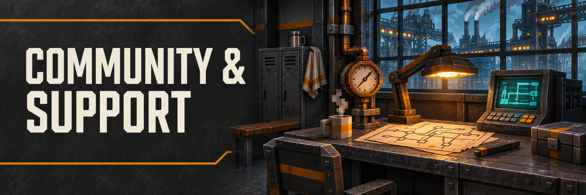

# GregTech: Industrial Brain Damage

Хардкорная экспертная сборка для **Minecraft 1.20.1, Forge 47.4.28 и Java 17**. Начни с ручных инструментов, собери мастерскую Create и паровой цех, затем пройди уровни GregTech от LV до UV. После UV откроются ещё три производственные ступени. Финал потребует запустить завод, который получает поставки из трёх измерений.

Из бревна и ножа выходят **две доски**, нож при этом изнашивается. Механическая пила Create даёт **четыре**. Новый станок имеет смысл строить ради выхода материала, скорости обработки или контроля над процессом.

## Собери единое производство

- Create отвечает за первые приводы, распил, смешивание и прессование. GregTech развивает пар, электрику, металлургию и промышленную химию.
- Immersive Engineering даёт штамповку и тяжёлое оборудование. PneumaticCraft добавляет камеры давления, герметизацию и полимеры в те же цепочки.
- Обычные ящики служат местным складом. Контроллер ящиков и первая сеть AE2 открываются на MV, шаблоны обработки на HV. Буферы ExtendedAE передают предметы и жидкости на входы сборочных линий GregTech в нужном порядке.
- Древесные фермы Forestry открываются на LV, пчеловодство Forestry и Gendustry на HV. Железная дорога Create идёт отдельной веткой. Для перевозок можно использовать предметные и жидкостные трубы.

## Выстраивай производственные цепочки

**2 126 квестов в 19 главах** связывают станки, материалы и следующий производственный шаг. Уровни напряжения и отдельные направления вроде AE2, лесного хозяйства и железной дороги идут своими главами. Наладь поставки из обычного мира, Нижнего мира и Энда. После UV собери линии эксплуатации, регенерации и распределения, затем наладь возврат нагретого теплоносителя и отработанного электролита.

## Сдай завод в эксплуатацию

Запусти завод на резерве, переключись на основной ввод и пройди два пятиминутных провала питания. После 90 минут основной смены проведи два двухминутных испытания, на которых одновременно работают металл, полимеры и электроника. Сдай пять протоколов и сетевой сертификат. Для итогового заказа нужны 15 предметных входов в заданном порядке и четыре жидкости.

**Для установки** импортируй ZIP сборки в CurseForge и создай новый мир. Перед обновлением сохрани резервную копию миров. За следующим шагом обращайся к книге FTB Quests, за рецептом к JEI. У сборки свой анимированный экран загрузки, главное меню и экран паузы.

## Проект и авторы

Сообщай о багах, делись схемами производства и задавай вопросы в [Discord](https://discord.gg/PppDQ2ZE6P). Файлы проекта и задачи доступны на [GitHub](https://github.com/klaran3e-hub/gregtech-industrial-brain-damage).

В сборку входит официальный CC: Tweaked 1.116.1 для Forge от Daniel Ratcliffe, SquidDev и участников проекта. [Официальный файл](https://modrinth.com/mod/cc-tweaked/version/OMIJHNkd) · [Исходники и лицензии](https://github.com/cc-tweaked/CC-Tweaked/tree/v1.20.1-1.116.1)

Баннеры на странице созданы с помощью ИИ.
